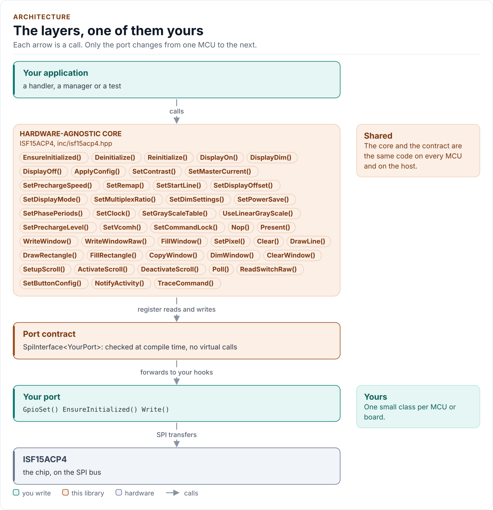
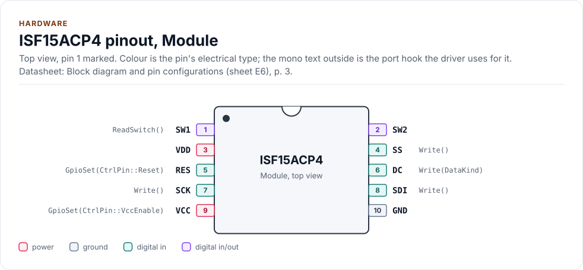
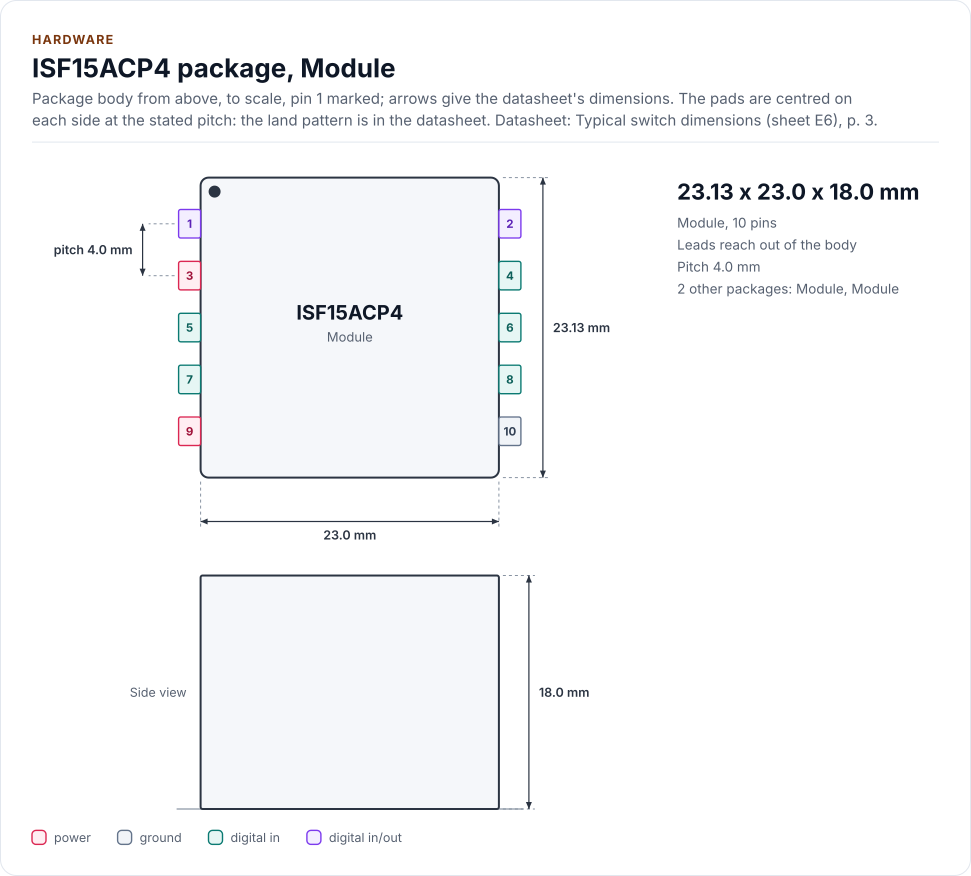
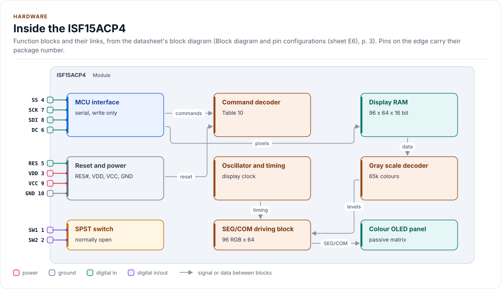

# ISF15ACP4 Driver

C++20 driver for the NKK ISF15ACP4 frameless OLED pushbutton: a 96RGB x 64 SSD1331-class OLED on write-only SPI and a
debounced SPST switch.

[](https://github.com/kokeb-labs-drivers/driver-isf15acp4/actions/workflows/ci.yml)
[](LICENSE)
[](docs/installation.md#requirements)

**Documentation: [`docs/`](docs/index.md)**, with the API reference built by Doxygen ([how](docs/api-reference.md)).
The site at <https://kokeb-labs-drivers.github.io/driver-isf15acp4/> opens when the repository is public.


The ISF15ACP4 is a pushbutton with a 96 RGB x 64 colour OLED in its cap and a normally-open switch under it. This
driver powers the OLED in the order the datasheet requires, draws pixels, rectangles and lines, scrolls, and turns the
switch into press, release, long-press and repeat events. It runs on any MCU: you give it a small class that moves
bytes on the SPI bus and drives three pins, and it does the rest. The SPI bus is write only, so the driver is verified
against a model of the controller, and says so ([Limitations](docs/limitations.md)).

<!-- figure: driver-layers -->
<picture>
  <source media="(prefers-color-scheme: dark)" srcset="docs/diagrams/driver-layers.dark.svg">
  
</picture>
<!-- /figure -->

## At a glance

| | |
| --- | --- |
| **Module** | NKK ISF15ACP4 frameless OLED pushbutton; presets for the ISC15ANP4 (64 x 48) and ISC01P (52 x 36, no switch) |
| **Display** | 96 RGB x 64, 65 536 colours (256-colour mode too), SSD1331-class controller; VDD 2.4 V to 3.5 V, VCC 14 V to 16 V (ISC15ANP4, ISC01P: 15 V to 17 V), external |
| **Bus** | Write-only SPI mode 0, up to 6.6 MHz, with D/C#, RES# and CS#; no MISO, no readback |
| **Also drives** | The enable of the 15 V OLED supply, which it never switches on before the controller is configured |
| **Switch** | SPST normally open, read by `Poll()`: debounce, press, release, long press, repeat; idle dim and sleep |
| **Driver** | Header-only C++20; no heap, exceptions, RTTI or virtual calls; every call returns `Result<T>`; an invalid argument sends nothing |
| **Runs on** | Any MCU with SPI and a C++20 compiler; the host example runs on any PC ([Platforms](docs/platforms.md)) |
| **Status** | 0.1.0, **not verified on hardware**: host-tested against an independent model of the controller |

<!-- figure: chip-pinout -->
<picture>
  <source media="(prefers-color-scheme: dark)" srcset="docs/diagrams/chip-pinout.dark.svg">
  
</picture>
<!-- /figure -->

<!-- figure: chip-outline -->
<picture>
  <source media="(prefers-color-scheme: dark)" srcset="docs/diagrams/chip-outline.dark.svg">
  
</picture>
<!-- /figure -->

<!-- figure: chip-blocks -->
<picture>
  <source media="(prefers-color-scheme: dark)" srcset="docs/diagrams/chip-blocks.dark.svg">
  
</picture>
<!-- /figure -->

<!-- generated: chip-card -->
| | | Datasheet |
| --- | --- | --- |
| **Package** | Module | Block diagram and pin configurations (sheet E6), [p. 3](https://www.nkkswitches.com/pdf/ISF15ACP4_FramelessOLED.pdf#page=3) |
| **Pins** | 10 | Block diagram and pin configurations (sheet E6), [p. 3](https://www.nkkswitches.com/pdf/ISF15ACP4_FramelessOLED.pdf#page=3) |
| **Body size** | 23.13 x 23.0 x 18.0 mm | Typical switch dimensions (sheet E6), [p. 3](https://www.nkkswitches.com/pdf/ISF15ACP4_FramelessOLED.pdf#page=3) |
| **Pin pitch** | 4.0 mm | Typical switch dimensions (sheet E6), [p. 3](https://www.nkkswitches.com/pdf/ISF15ACP4_FramelessOLED.pdf#page=3) |
| **Variants** | `isc15anp4`, `isc01p` (below) | Block diagram and pin configurations (sheet E6), [p. 3](https://www.nkkswitches.com/pdf/ISC15ANP4.pdf#page=3) |
| **Supply VDD** | 2.4 V to 3.5 V | Recommended operating conditions (sheet E5), [p. 2](https://www.nkkswitches.com/pdf/ISF15ACP4_FramelessOLED.pdf#page=2) |
| **Supply VCC** | 14.0 V to 16.0 V | Recommended operating conditions (sheet E5), [p. 2](https://www.nkkswitches.com/pdf/ISF15ACP4_FramelessOLED.pdf#page=2) |
| **Supply VCC (ISC15ANP4, ISC01P)** | 15.0 V to 17.0 V | Recommended operating conditions (sheet E5), [p. 2](https://www.nkkswitches.com/pdf/ISF15ACP4_FramelessOLED.pdf#page=2) |

Also sold as:

| Variant | Package | Pins | Size | Ordering | Note | Datasheet |
| --- | --- | --- | --- | --- | --- | --- |
| `isc15anp4` | Module | 10 | 64 x 48 pixels | ISC15ANP4 | pushbutton with a smaller display, the same 10 pins; VCC 15 V to 17 V; its column offset and init values are in PresetFor() | Block diagram and pin configurations (sheet E6), [p. 3](https://www.nkkswitches.com/pdf/ISC15ANP4.pdf#page=3) |
| `isc01p` | Module | 8 | 52 x 36 pixels | ISC01P | display only, 8 pins (VDD, SS, RES, D/C, SCK, SDI, VCC, GND); VCC 15 V to 17 V; no switch (HasSwitch() is false) | Switch and OLED specifications (sheets E5, E6), [p. 2](https://www.nkkswitches.com/pdf/ISC01P.pdf#page=2) |

From [`docs/hardware.yml`](docs/hardware.yml); pins, circuits and the block diagram: [Hardware](docs/hardware.md).
<!-- /generated -->

## Datasheet

<!-- generated: datasheet-card -->
| Document | Revision | Get it |
| --- | --- | --- |
| Datasheet: Frameless OLED Pushbutton ISF15ACP4 (NKK Switches ISF15ACP4_FramelessOLED (sheets E4 to E9, no number printed)) | none printed, 2019-10-03 | [PDF](https://www.nkkswitches.com/pdf/ISF15ACP4_FramelessOLED.pdf) · [vendor page](https://www.nkkswitches.com/pdf/ISF15ACP4_FramelessOLED.pdf) |
| Datasheet: SSD1331 96RGB x 64 Dot Matrix OLED/PLED Segment/Common Driver with Controller (Solomon Systech (copy from the Adafruit mirror) SSD1331) | 1.2, Nov 2007 | [PDF](https://cdn-shop.adafruit.com/datasheets/SSD1331_1.2.pdf) · [vendor page](https://cdn-shop.adafruit.com/datasheets/SSD1331_1.2.pdf) |
| Datasheet: Frameless OLED Pushbutton ISC15ANP4 (variant, 64 x 48) (NKK Switches ISC15ANP4 (sheets E4 to E9, no number printed)) | none printed, 2019-10-03 | [PDF](https://www.nkkswitches.com/pdf/ISC15ANP4.pdf) · [vendor page](https://www.nkkswitches.com/pdf/ISC15ANP4.pdf) |
| Datasheet: OLED module ISC01P (variant, 52 x 36, display only) (NKK Switches ISC01P (sheets E4 to E9, no number printed)) | none printed, 2019-10-03 | [PDF](https://www.nkkswitches.com/pdf/ISC01P.pdf) · [vendor page](https://www.nkkswitches.com/pdf/ISC01P.pdf) |
| Application note: Application Notes for the OLED Color SmartDisplay (web page) (NKK Switches OLED application notes) | none printed (web page), not printed | [vendor page](https://docs.nkkswitches.com/docs/application-notes/oled-application-notes/) |
| Application note: IS-CHPMP and IS-CHPMPHP charge pump manual (NKK Switches IS-CHPMP and IS-CHPMPHP Manual) | C, 0617 (as printed on every page) | [vendor page](https://docs.nkkswitches.com/docs/application-notes/oled-application-notes/) |
| Application note: OLED Engineering Kits User Manual (web page) (NKK Switches OLED engineering kits) | none printed (web page), not printed | [vendor page](https://docs.nkkswitches.com/docs/engineering-kits/oled-engineering-kits-user-manual/) |

Written against these revisions; the SHA-256 of each file is in [`docs/datasheets.yml`](docs/datasheets.yml). Where each
part of the driver is in the datasheet: [Datasheet map](docs/datasheet.md).
<!-- /generated -->

Every docs page lists the datasheet sections it relies on, and code comments cite the section they implement.

## Try it on your PC

No hardware needed: [`examples/host`](examples/host/README.md) runs the driver against a simulated chip.
You need git, CMake 3.16+ and a C++20 compiler (GCC 10+, Clang 13+ or MSVC 2022).

1. Get the source:

   ```bash
   git clone https://github.com/kokeb-labs-drivers/driver-isf15acp4.git && cd driver-isf15acp4
   ```

2. Build and run the example:

   ```bash
   cmake -S examples/host -B build-example
   cmake --build build-example
   ./build-example/isf15acp4_host_example
   ```

3. You should see the driver start the simulated module, draw, follow a long press of the switch and power down:

   ```text
   ISF15ACP4 driver 0.1.0 on the host
   isf15acp4: initialised, supply off
   isf15acp4: supply on
     event 1 at 1235 ms
     event 3 at 2035 ms
     event 2, held 1000 ms
   isf15acp4: display and supply off
   3 button events; panel lit: yes; power-down clean: yes
   ```

To run the whole test suite instead: `cmake -S . -B build -DISF15ACP4_BUILD_TESTS=ON && cmake --build build && ctest
--test-dir build`.

## Use it on your MCU

**1. Wire it** ([Hardware](docs/hardware.md) has every pin, the timing and the power order):

| MCU | Module pin | Notes |
| --- | --- | --- |
| SPI SCLK | 7 SCK | Mode 0, up to 6.6 MHz; 1 to 4 MHz for bring-up |
| SPI MOSI | 8 SDI | There is no data out: leave MISO unconnected |
| GPIO (chip select) | 4 SS | Low for each transfer |
| GPIO | 6 D/C | Low for a command, high for pixel data |
| GPIO | 5 RES | Idles high |
| GPIO | enable of your 15 V supply | Active high; pull it down so it is off through reset and boot |
| 3.3 V | 3 VDD | 2.4 V to 3.5 V |
| 15 V supply | 9 VCC | 14 V to 16 V (ISC15ANP4, ISC01P: 15 V to 17 V), switched by the enable above |
| GPIO input, pull-up | 1 SW | Pin 2 to ground; closed reads low |
| GND | 10 GND | |

**2. Write the port**: a class with `EnsureInitialized()` (bring the bus and pins up at their idle levels), `Write()` (one
write-only transfer, D/C# set for the kind), `GpioSet()` (RES# and the supply enable) and `DelayUs()`, about 30 lines on
most SDKs, plus optional `ReadSwitch()`, `NowMs()` and `Log()` hooks. [Porting](docs/porting.md) has the contract and a
complete example.

**3. Show something:**

<!-- generated: quickstart-code -->
```cpp
#include "isf15acp4.hpp"

int show_hello(MyPort& port) {
  isf15acp4::ISF15ACP4<MyPort> panel(port); // no I/O yet

  if (auto r = panel.EnsureInitialized();
      !r) {                           // 1. reset, configure, clear: the supply is still off
    return static_cast<int>(r.error); //    Bus or InvalidArgument: check wiring and Config
  }
  if (auto r = panel.DisplayOn(); !r) { // 2. only now is the 15 V supply enabled and the panel on
    return static_cast<int>(r.error);
  }
  if (auto r = panel.DrawRectangle(0, 0, 95, 63, isf15acp4::kWhite); !r) { // 3. draw
    return static_cast<int>(r.error);
  }
  static_cast<void>(panel.Deinitialize()); // 4. display off, supply off, wait: always runs
  return 0;
}
```
<!-- /generated -->

`EnsureInitialized()` is the only call that starts the module, and it leaves the 15 V supply off. `DisplayOn()` is the
only call that enables it. Every other call returns `Error::NotInitialized` until the start has succeeded.

## What it does

- Starts the controller with the supply off: reset pulse, the full configuration, RAM cleared; then `DisplayOn()` enables
  the supply and turns the panel on. The power-down always runs and never waits on a transfer that failed.
- Writes pixel windows in 65k, 256 and 65k format 2, in either RAM increment mode; draws lines and rectangles, copies,
  dims and clears with the controller's own engine; scrolls; sets contrast, current, gray scale, remap and the rest of
  the command set.
- Debounces the switch and reports press, release, long press and repeat; dims and sleeps the display when idle and
  wakes it on a press.
- Returns `Result<T>` with an `Error` from every call: no exceptions, no heap, no RTTI, no virtual calls. An invalid
  argument sends nothing.
- States what a write-only bus cannot do: the driver cannot read anything back, and cannot see a reset of the
  controller ([Limitations](docs/limitations.md)).

## Add it to your project

Pick the row that matches your build; each is a few steps, and [Installation](docs/installation.md) has the
details.

| Your build | Steps below |
| --- | --- |
| Plain CMake: STM32 (CubeMX), RP2040 (Pico SDK), nRF Connect, a host app | [A](#a-cmake-any-mcu) |
| ESP-IDF | [B](#b-esp-idf) |
| An SDK or OS image that installs libraries | [C](#c-installed-package) |

### A. CMake, any MCU

1. Add the driver as a submodule, pinned to the version you chose:

   ```bash
   git submodule add https://github.com/kokeb-labs-drivers/driver-isf15acp4.git external/driver-isf15acp4
   ```

2. In your `CMakeLists.txt`, after `project()`:

   ```cmake
   add_subdirectory(external/driver-isf15acp4)
   target_link_libraries(my_app PRIVATE isf15acp4::isf15acp4)   # brings the headers and C++20
   ```

3. In your code, `#include "isf15acp4.hpp"`, write the port ([Porting](docs/porting.md)) and build. A first build
   that compiles the quickstart above is the check that the driver is wired in.

### B. ESP-IDF

1. Add the driver under your project's `components/`; ESP-IDF finds it there and names it after the folder:

   ```bash
   git submodule add https://github.com/kokeb-labs-drivers/driver-isf15acp4.git components/isf15acp4
   ```

2. In `main/CMakeLists.txt`, list it: `idf_component_register(SRCS "main.cpp" REQUIRES isf15acp4)`.
3. `idf.py menuconfig` now has a **ISF15ACP4 OLED pushbutton** menu (module, current, colour wiring, switch, idle times),
   and `idf.py build` builds the driver with your app. [`examples/esp32`](examples/esp32) is a complete
   project with a port for the board.

### C. Installed package

1. Install it once into a prefix:

   ```bash
   cmake -S external/driver-isf15acp4 -B build-isf15acp4 && cmake --install build-isf15acp4 --prefix /opt/sdk
   ```

2. In your project, with `CMAKE_PREFIX_PATH=/opt/sdk`:

   ```cmake
   find_package(isf15acp4 0.1 REQUIRED)
   target_link_libraries(my_app PRIVATE isf15acp4::isf15acp4)
   ```

The target is `isf15acp4::isf15acp4` every way, so switching later changes nothing else.

## Documentation

| Page | Read it when you want to |
| --- | --- |
| [Quickstart](docs/quickstart.md) | Go from a bare module to a picture on your MCU |
| [Hardware](docs/hardware.md) | Wire it, check the bus settings, the supplies, the timing and the power order |
| [Porting](docs/porting.md) | Write the port class for your MCU's SDK |
| [API guide](docs/api-guide.md) | Use each call: start, draw, scroll, follow the button, handle errors |
| [Configuration](docs/configuration.md) | Choose every setting, or start from a module preset |
| [Troubleshooting](docs/troubleshooting.md) | Find the cause of an error, a dark panel or a wrong picture |
| [Contract](docs/contract.md) | Know what the driver promises, its power order, and what it returns |
| [Ambiguities](docs/ambiguities.md) | See what the datasheets leave open and the setting for each |
| [Limitations](docs/limitations.md) | Know what the write-only bus and the missing hardware test mean for you |
| [Datasheet map](docs/datasheet.md) | Find the datasheet section behind each part of the driver |
| [API reference](docs/api-reference.md) | Look up a class or member (Doxygen; built by CI and locally) |

## Tests and quality

```bash
cmake -S . -B build -DISF15ACP4_BUILD_TESTS=ON && cmake --build build && ctest --test-dir build
```

The host tests run the driver against an independent model of the controller's pins and commands, fail every transfer
of a full run in turn, and produce each error the driver can return. The model reports a violation when the driver
enables the OLED supply too early, cuts it with the display on, or breaks any other rule of the datasheet's power
sequence. A fuzzer injects failed transfers, failed pins and a brown-out of the controller, and checks the driver's
promises after every call. CI also builds for Cortex-M and gates coverage, complexity, sanitizers, fuzzing,
clang-tidy, cppcheck and the handbook rules (`.kokeb/handbook.yml`). See [Testing and CI](docs/testing.md), which lists
every gate and its limit.

## License

MIT. See [LICENSE](LICENSE).
