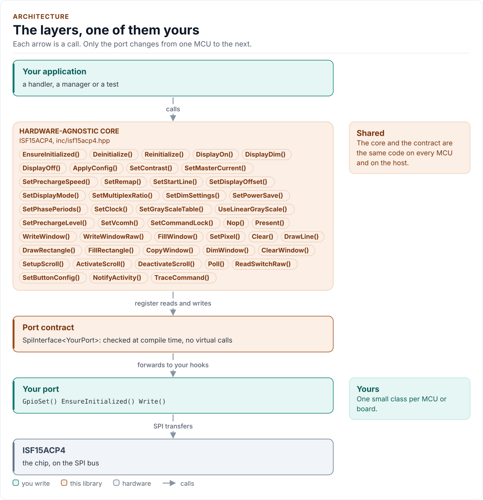
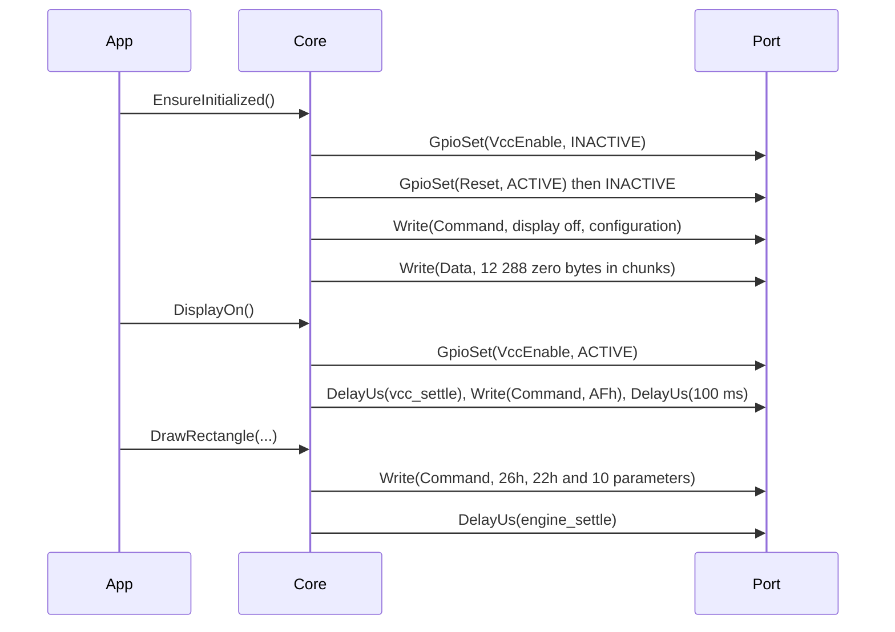

# Architecture

How the driver is built: three layers, one of them yours, and what happens in each when you show something.

<!-- generated: datasheet-refs -->
??? abstract "Datasheet sections this page relies on"

    - Supply voltages, current and the three power states: NKK Switches ISF15ACP4_FramelessOLED (sheets E4 to E9, no number printed) none printed, Recommended operating conditions (sheets E5, E7), [p. 2](https://www.nkkswitches.com/pdf/ISF15ACP4_FramelessOLED.pdf#page=2)
    - Serial interface framing, D/C# and chip select: Solomon Systech (copy from the Adafruit mirror) SSD1331 1.2, 7.1.3 Serial Interface, [p. 17](https://cdn-shop.adafruit.com/datasheets/SSD1331_1.2.pdf#page=17)
    - GDDRAM and colour depth: Solomon Systech (copy from the Adafruit mirror) SSD1331 1.2, 7.5 Graphic Display Data RAM; Table 9, [p. 20](https://cdn-shop.adafruit.com/datasheets/SSD1331_1.2.pdf#page=20)
    - Power on and off sequence: Solomon Systech (copy from the Adafruit mirror) SSD1331 1.2, 7.9 Power ON and OFF Sequence, [p. 27](https://cdn-shop.adafruit.com/datasheets/SSD1331_1.2.pdf#page=27)
    - Command table and parameter counts: Solomon Systech (copy from the Adafruit mirror) SSD1331 1.2, 8 Command Table, Table 10, [p. 28](https://cdn-shop.adafruit.com/datasheets/SSD1331_1.2.pdf#page=28)

    All of them, with the driver API for each: [Datasheet map](datasheet.md).
<!-- /generated -->

<!-- figure: driver-layers -->
<picture>
  <source media="(prefers-color-scheme: dark)" srcset="diagrams/driver-layers.dark.svg">
  
</picture>
<!-- /figure -->

## Layers

| Layer | Files | Owns |
| --- | --- | --- |
| Core | [`inc/isf15acp4.hpp`](../inc/isf15acp4.hpp), [`src/isf15acp4.ipp`](../src/isf15acp4.ipp) | The power sequence, configuration, pixel windows, the drawing engine, scrolling, the switch, errors |
| Chip definitions | [`inc/isf15acp4_registers.hpp`](../inc/isf15acp4_registers.hpp), [`inc/isf15acp4_types.hpp`](../inc/isf15acp4_types.hpp), [`inc/isf15acp4_button.hpp`](../inc/isf15acp4_button.hpp), [`inc/isf15acp4_detail.hpp`](../inc/isf15acp4_detail.hpp) | The command table and its constants, `Config`, `Error`, colours, the debouncer, compile-time helpers |
| Port contract | [`inc/isf15acp4_spi_interface.hpp`](../inc/isf15acp4_spi_interface.hpp) | The bus requirements, `CtrlPin`, `DataKind`, the `SpiPort` concept |
| Platform port | Your class | Bus and pin bring-up, one write-only transfer, two control pins, a delay, optionally the switch pin, a clock, logging |

The debouncer is a separate class with no port and no clock: `ButtonDebouncer::Update(down, now_ms)` is a pure state
machine, tested alone, and `Poll()` feeds it from the port.

## Show something

Every method is one or a few transfers. The core keeps command and pixel buffers as members (`command_`, `data_`), so
no call allocates and a `Write()` always gets a pointer that stays valid until it returns.

## The controller model in the tests

The tests do not use a register map of the controller. They use a model that behaves like the controller on the pins:
it decodes commands from its own copy of Table 10, keeps the display RAM, runs the drawing engine and the scroll
state, tracks RES#, VCC, CS# and D/C#, keeps a virtual clock that `DelayUs()` advances, and records a violation when a
rule of the datasheet is broken. [Testing and CI](testing.md) describes it.

## Optional hooks

`ReadSwitch()`, `NowMs()` and `Log()` are found at compile time with named concepts in `isf15acp4::detail`; a hook
declared with the wrong signature is a `static_assert` that names it, so a typo is never a silently missing hook. A port
without them still gets the full display driver; `Poll()` returns `Unsupported`.

## Design decisions

- **No canvas, no font.** The driver stops at the controller: pixel windows, the controller's own engine and
  scrolling. A frame buffer would cost 12 kB of RAM that most users of a one-button display do not want to spend,
  and a font is a data and licence decision for the application. The colour type and `WriteWindow()` are what a
  graphics layer needs; see [Limitations](limitations.md#no-canvas-and-no-font).
- **A shadow, not a state machine of the chip.** Because nothing can be read back, the driver keeps only what it needs
  to refuse unsafe sequences (initialised, supply on, locked, scrolling). It does not predict what the chip shows.
- **Three colour depths, one API.** `Color` is always RGB565; the driver encodes each pixel for the depth in the
  configuration, including the segment order that follows from the panel wiring.
