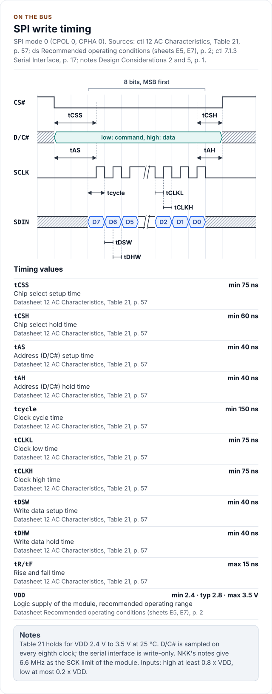

# On the bus

What the ISF15ACP4 needs from the SPI bus, signal by signal, with every time taken from the SSD1331 controller
datasheet and the module's limits from the NKK sheet. The pins and the wiring are on the [Hardware](hardware.md)
page; this page is the waveform under them.

<!-- generated: datasheet-refs -->
??? abstract "Datasheet sections this page relies on"

    - Supply voltages, current and the three power states: NKK Switches ISF15ACP4_FramelessOLED (sheets E4 to E9, no number printed) none printed, Recommended operating conditions (sheets E5, E7), [p. 2](https://www.nkkswitches.com/pdf/ISF15ACP4_FramelessOLED.pdf#page=2)
    - Serial interface framing, D/C# and chip select: Solomon Systech (copy from the Adafruit mirror) SSD1331 1.2, 7.1.3 Serial Interface, [p. 17](https://cdn-shop.adafruit.com/datasheets/SSD1331_1.2.pdf#page=17)
    - Serial interface timing: Solomon Systech (copy from the Adafruit mirror) SSD1331 1.2, 12 AC Characteristics, Table 21, [p. 57](https://cdn-shop.adafruit.com/datasheets/SSD1331_1.2.pdf#page=57)
    - Communication, SCK frequency and chip select: NKK Switches OLED application notes none printed (web page), Design Considerations 2 and 5, p. 1

    All of them, with the driver API for each: [Datasheet map](datasheet.md).
<!-- /generated -->

## SPI timing

The controller shifts SDIN in on every rising edge of SCLK, D7 first, and samples D/C# on every eighth clock: low
writes the byte to the command register, high to the display RAM. The bus is write-only. The driver uses mode 0 (mode
3 also works) and sends one command with its parameters, or one run of pixel bytes, while CS# stays low.

<!-- figure: spi-timing -->
<picture>
  <source media="(prefers-color-scheme: dark)" srcset="diagrams/spi-timing.dark.svg">
  
</picture>
<!-- /figure -->

## Several devices

The datasheet describes no daisy chain and no address: each module has its own SS pin (pin 4, CS# of the
controller). Several modules on one bus share SCK, SDI and D/C and each gets its own SS; that is general SPI practice,
not something the NKK sheet draws, so there is no topology figure.

## How these figures are made

Each figure is a model in `docs/model/` (`spi-timing.timing.yml`) that cites the datasheet section and page of every
number; `kokeb-docs figures` draws it and the build fails on a number without a citation. The values table under the
waveform is also written as `docs/diagrams/spi-timing.table.html`.
