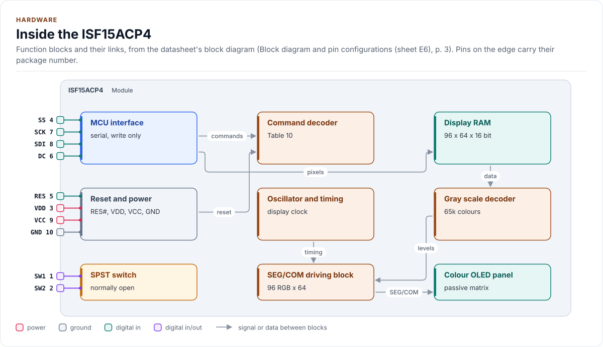
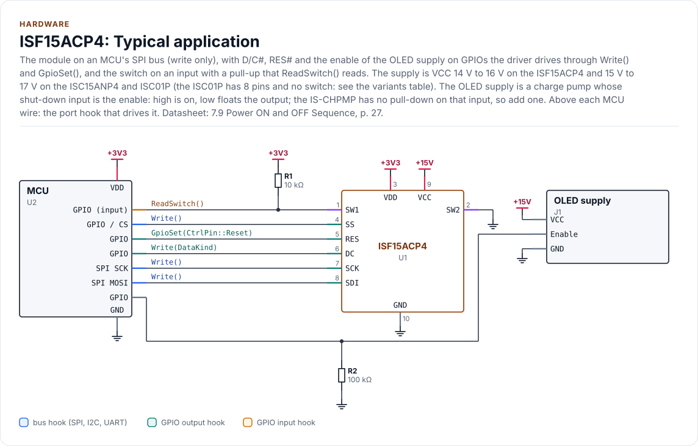
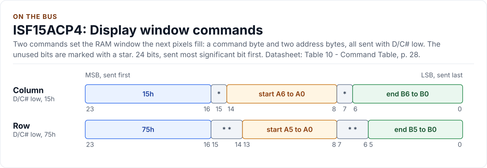
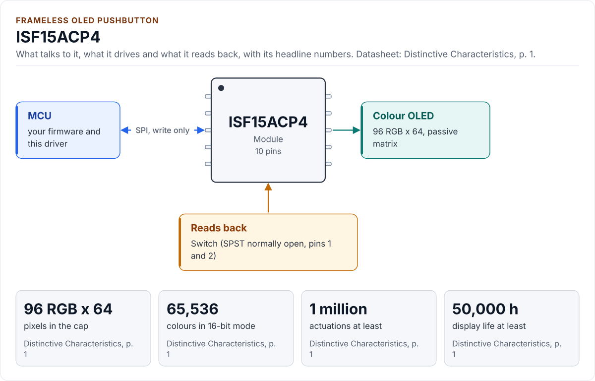
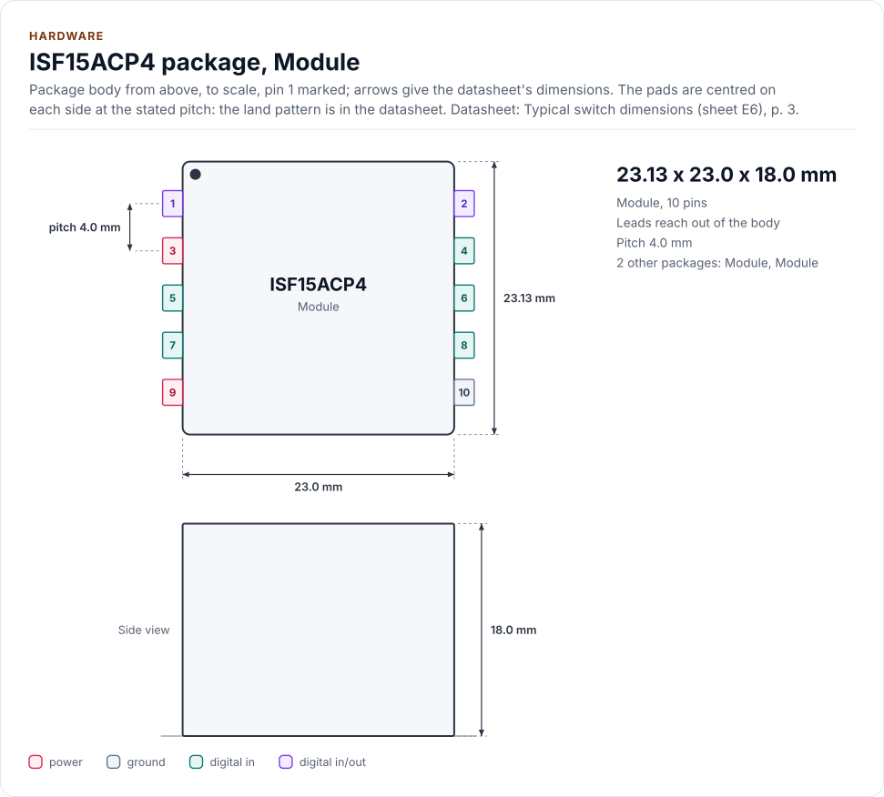
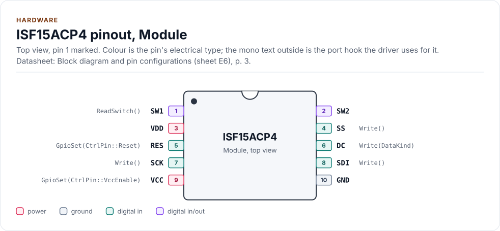
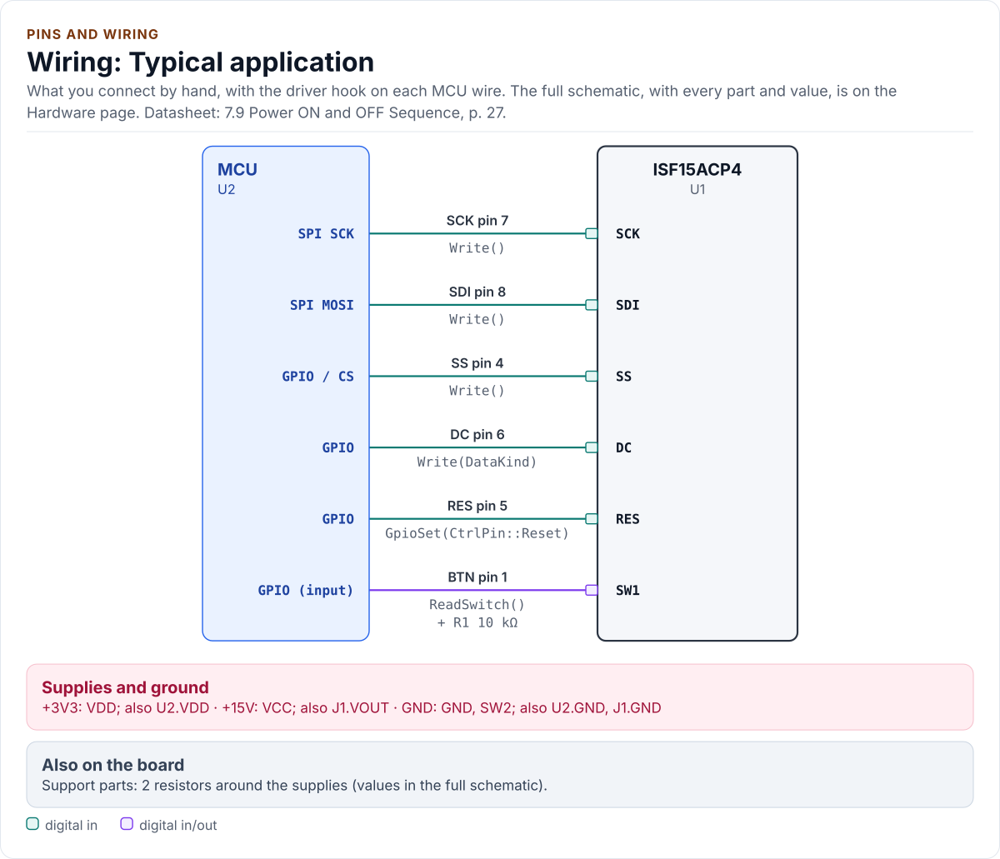
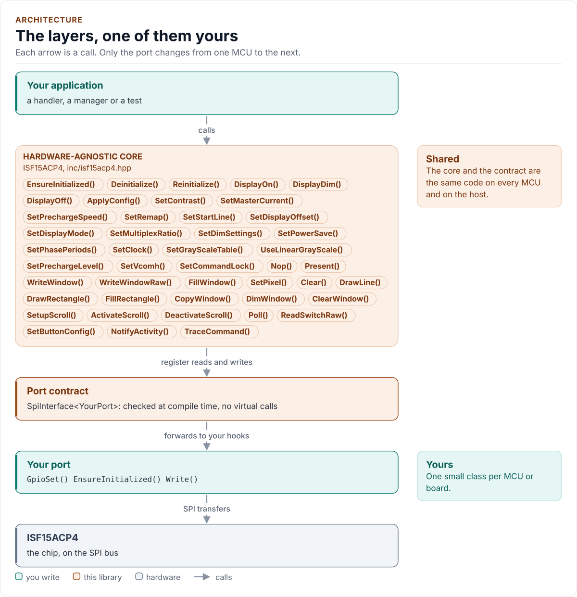
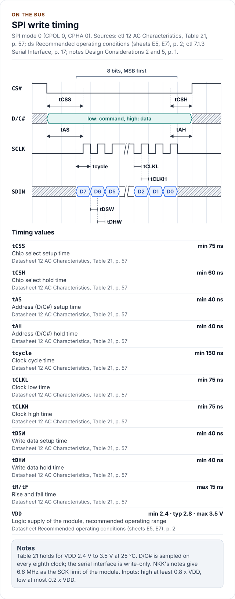
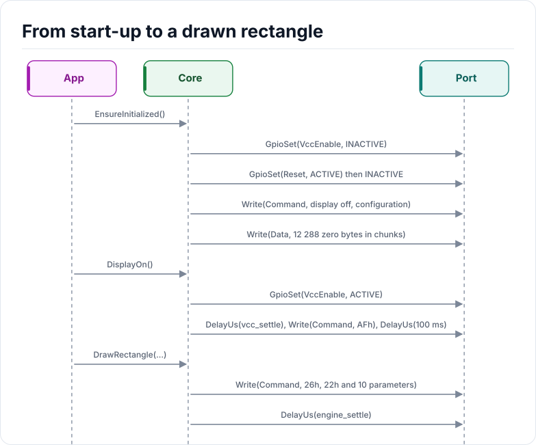

# Figures

<!-- Written by kokeb-docs figures from docs/diagrams/figures/*.py. Do not edit by hand. -->

Every figure on this site is drawn by a Python module from facts extracted from the code, so it is rebuilt,
not redrawn, when the code changes. CI runs `kokeb-docs figures --check` and fails when a
committed figure no longer matches the code. Each figure below lists the files it is drawn from.

## Inside the ISF15ACP4

<!-- figure: chip-blocks -->
<picture>
  <source media="(prefers-color-scheme: dark)" srcset="chip-blocks.dark.svg">
  
</picture>
<!-- /figure -->

Hardware description: [`docs/hardware.yml`](../hardware.yml)

Drawn from:

- [`docs/hardware.yml`](../hardware.yml)
- [`inc/isf15acp4.hpp`](../../inc/isf15acp4.hpp)
- [`inc/isf15acp4_spi_interface.hpp`](../../inc/isf15acp4_spi_interface.hpp)

## What the ISF15ACP4 does

<!-- figure: chip-capabilities -->
<picture>
  <source media="(prefers-color-scheme: dark)" srcset="chip-capabilities.dark.svg">
  
</picture>
<!-- /figure -->

Hardware description: [`docs/hardware.yml`](../hardware.yml)

Drawn from:

- [`docs/hardware.yml`](../hardware.yml)
- [`inc/isf15acp4.hpp`](../../inc/isf15acp4.hpp)
- [`inc/isf15acp4_spi_interface.hpp`](../../inc/isf15acp4_spi_interface.hpp)

## ISF15ACP4: Typical application

<!-- figure: chip-circuit-typical -->
<picture>
  <source media="(prefers-color-scheme: dark)" srcset="chip-circuit-typical.dark.svg">
  
</picture>
<!-- /figure -->

Hardware description: [`docs/hardware.yml`](../hardware.yml)

Drawn from:

- [`docs/hardware.yml`](../hardware.yml)
- [`inc/isf15acp4.hpp`](../../inc/isf15acp4.hpp)
- [`inc/isf15acp4_spi_interface.hpp`](../../inc/isf15acp4_spi_interface.hpp)

## ISF15ACP4: Display window commands

<!-- figure: chip-frame-window -->
<picture>
  <source media="(prefers-color-scheme: dark)" srcset="chip-frame-window.dark.svg">
  
</picture>
<!-- /figure -->

Hardware description: [`docs/hardware.yml`](../hardware.yml)

Drawn from:

- [`docs/hardware.yml`](../hardware.yml)
- [`inc/isf15acp4.hpp`](../../inc/isf15acp4.hpp)
- [`inc/isf15acp4_spi_interface.hpp`](../../inc/isf15acp4_spi_interface.hpp)

## ISF15ACP4

<!-- figure: chip-hero -->
<picture>
  <source media="(prefers-color-scheme: dark)" srcset="chip-hero.dark.svg">
  
</picture>
<!-- /figure -->

Hardware description: [`docs/hardware.yml`](../hardware.yml)

Drawn from:

- [`docs/hardware.yml`](../hardware.yml)
- [`inc/isf15acp4.hpp`](../../inc/isf15acp4.hpp)
- [`inc/isf15acp4_spi_interface.hpp`](../../inc/isf15acp4_spi_interface.hpp)

## ISF15ACP4 package, Module

<!-- figure: chip-outline -->
<picture>
  <source media="(prefers-color-scheme: dark)" srcset="chip-outline.dark.svg">
  
</picture>
<!-- /figure -->

Hardware description: [`docs/hardware.yml`](../hardware.yml)

Drawn from:

- [`docs/hardware.yml`](../hardware.yml)
- [`inc/isf15acp4.hpp`](../../inc/isf15acp4.hpp)
- [`inc/isf15acp4_spi_interface.hpp`](../../inc/isf15acp4_spi_interface.hpp)

## ISF15ACP4 pinout, Module

<!-- figure: chip-pinout -->
<picture>
  <source media="(prefers-color-scheme: dark)" srcset="chip-pinout.dark.svg">
  
</picture>
<!-- /figure -->

Hardware description: [`docs/hardware.yml`](../hardware.yml)

Drawn from:

- [`docs/hardware.yml`](../hardware.yml)
- [`inc/isf15acp4.hpp`](../../inc/isf15acp4.hpp)
- [`inc/isf15acp4_spi_interface.hpp`](../../inc/isf15acp4_spi_interface.hpp)

## Wiring: Typical application

<!-- figure: chip-wiring-typical -->
<picture>
  <source media="(prefers-color-scheme: dark)" srcset="chip-wiring-typical.dark.svg">
  
</picture>
<!-- /figure -->

Hardware description: [`docs/hardware.yml`](../hardware.yml)

Drawn from:

- [`docs/hardware.yml`](../hardware.yml)
- [`inc/isf15acp4.hpp`](../../inc/isf15acp4.hpp)
- [`inc/isf15acp4_spi_interface.hpp`](../../inc/isf15acp4_spi_interface.hpp)

## The layers, one of them yours

<!-- figure: driver-layers -->
<picture>
  <source media="(prefers-color-scheme: dark)" srcset="driver-layers.dark.svg">
  
</picture>
<!-- /figure -->

Figure module: [`docs/diagrams/figures/driver-layers.py`](../../docs/diagrams/figures/driver-layers.py)

Drawn from:

- `public calls` in [`inc/isf15acp4.hpp`](../../inc/isf15acp4.hpp)
- `SpiInterface` in [`inc/isf15acp4_spi_interface.hpp`](../../inc/isf15acp4_spi_interface.hpp)

## SPI write timing

<!-- figure: spi-timing -->
<picture>
  <source media="(prefers-color-scheme: dark)" srcset="spi-timing.dark.svg">
  
</picture>
<!-- /figure -->

Hardware description: [`docs/model/spi-timing.timing.yml`](../model/spi-timing.timing.yml)

Drawn from:

- [`docs/model/spi-timing.timing.yml`](../model/spi-timing.timing.yml)

## From start-up to a drawn rectangle

<!-- figure: start-up-and-draw -->
<picture>
  <source media="(prefers-color-scheme: dark)" srcset="start-up-and-draw.dark.svg">
  
</picture>
<!-- /figure -->

Hardware description: [`docs/model/start-up-and-draw.seq.yml`](../model/start-up-and-draw.seq.yml)

Drawn from:

- [`docs/model/start-up-and-draw.seq.yml`](../model/start-up-and-draw.seq.yml)
