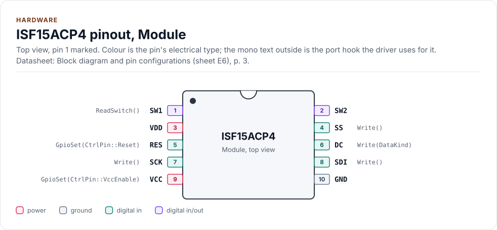
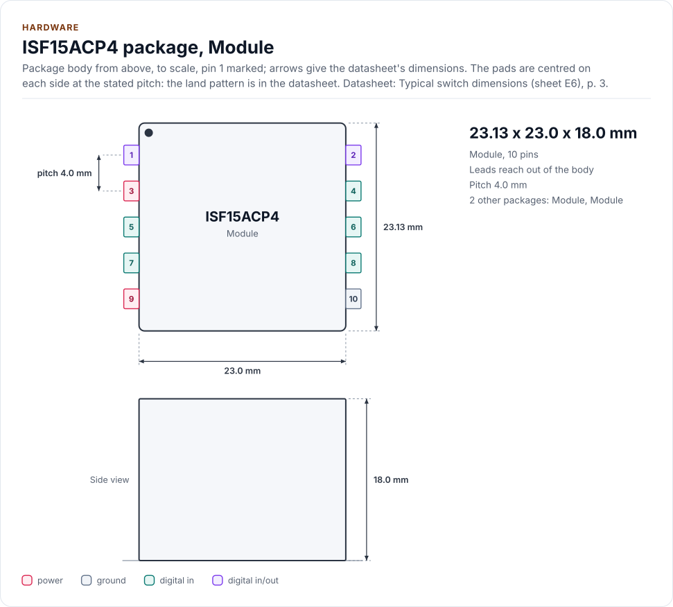
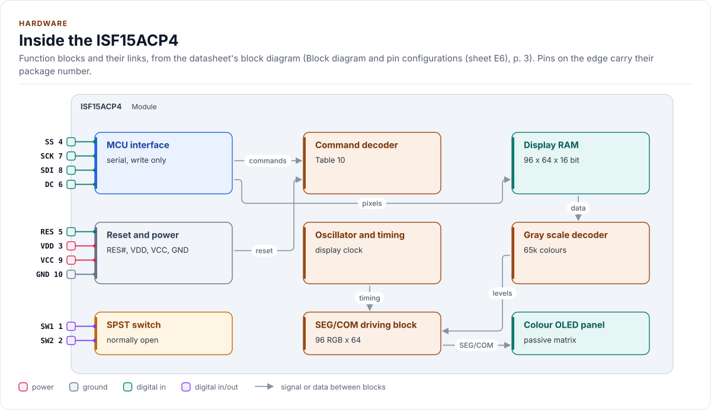
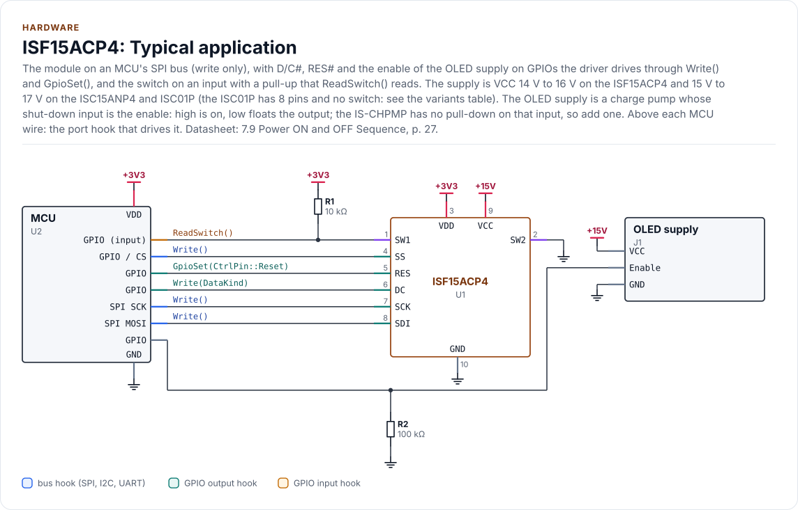

# Hardware

The module's pins, supplies, bus settings, timing and power order, as the driver uses them.

<!-- generated: datasheet-refs -->
??? abstract "Datasheet sections this page relies on"

    - Supply voltages, current and the three power states: NKK Switches ISF15ACP4_FramelessOLED (sheets E4 to E9, no number printed) none printed, Recommended operating conditions (sheets E5, E7), [p. 2](https://www.nkkswitches.com/pdf/ISF15ACP4_FramelessOLED.pdf#page=2)
    - Module pins, switch contacts and block diagram: NKK Switches ISF15ACP4_FramelessOLED (sheets E4 to E9, no number printed) none printed, Block diagram and pin configurations (sheet E6), [p. 3](https://www.nkkswitches.com/pdf/ISF15ACP4_FramelessOLED.pdf#page=3)
    - Serial interface framing, D/C# and chip select: Solomon Systech (copy from the Adafruit mirror) SSD1331 1.2, 7.1.3 Serial Interface, [p. 17](https://cdn-shop.adafruit.com/datasheets/SSD1331_1.2.pdf#page=17)
    - Reset circuit and reset pulse: Solomon Systech (copy from the Adafruit mirror) SSD1331 1.2, 7.4 Reset Circuit; 12 AC Characteristics, Table 18, [p. 19](https://cdn-shop.adafruit.com/datasheets/SSD1331_1.2.pdf#page=19)
    - Power on and off sequence: Solomon Systech (copy from the Adafruit mirror) SSD1331 1.2, 7.9 Power ON and OFF Sequence, [p. 27](https://cdn-shop.adafruit.com/datasheets/SSD1331_1.2.pdf#page=27)
    - Serial interface timing: Solomon Systech (copy from the Adafruit mirror) SSD1331 1.2, 12 AC Characteristics, Table 21, [p. 57](https://cdn-shop.adafruit.com/datasheets/SSD1331_1.2.pdf#page=57)
    - Start-up values of each module: NKK Switches OLED application notes none printed (web page), Initialization, Tables 1 to 3, steps 4.1 to 4.18 (Note 1, Note 2), p. 1
    - Supplies, VCC order and the charge pump: NKK Switches OLED application notes none printed (web page), Pin-outs; Design Considerations 1, Power Requirements VCC (16V); Part Numbers, p. 1
    - Communication, SCK frequency and chip select: NKK Switches OLED application notes none printed (web page), Design Considerations 2 and 5, p. 1
    - Memory window of each module: NKK Switches OLED application notes none printed (web page), Specifying a Memory Window for Downloading, p. 1
    - Charge pump shut-down input: NKK Switches IS-CHPMP and IS-CHPMPHP Manual C, 3. Pin Configurations, p. 5
    - Charge pump enable wiring in the kit: NKK Switches OLED engineering kits none printed (web page), Hardware Considerations, p. 1

    All of them, with the driver API for each: [Datasheet map](datasheet.md).
<!-- /generated -->

## The module

The ISF15ACP4 is a frameless pushbutton with a 96 RGB x 64 passive-matrix colour OLED in its cap. It has ten
through-hole terminals: two for the SPST switch (pins 1 and 2) and eight for the display (pins 3 to 10). The display
is driven by an SSD1331 of Solomon Systech: the NKK sheet does not name it, and NKK's application notes ("Part
Numbers": all OLED modules incorporate the same OLED controller, SSD1331) do
([Ambiguities](ambiguities.md#the-controller-is-named-in-the-application-notes)). The SSD1331 datasheet used came from a
mirror (the manufacturer's page lists the part and links no PDF): the documents, revisions and SHA-256 are in
[`docs/datasheets.yml`](datasheets.yml).

<!-- figure: chip-pinout -->
<picture>
  <source media="(prefers-color-scheme: dark)" srcset="diagrams/chip-pinout.dark.svg">
  
</picture>
<!-- /figure -->

<!-- figure: chip-outline -->
<picture>
  <source media="(prefers-color-scheme: dark)" srcset="diagrams/chip-outline.dark.svg">
  
</picture>
<!-- /figure -->

<!-- figure: chip-blocks -->
<picture>
  <source media="(prefers-color-scheme: dark)" srcset="diagrams/chip-blocks.dark.svg">
  
</picture>
<!-- /figure -->

## Pins

<!-- generated: chip-pins -->
Module, 10 pins (Block diagram and pin configurations (sheet E6), [p. 3](https://www.nkkswitches.com/pdf/ISF15ACP4_FramelessOLED.pdf#page=3)).

| Pin | Name | Type (domain) | Function | Driver hook | If unused | Datasheet |
| --- | --- | --- | --- | --- | --- | --- |
| 1 | `SW1` | digital in/out (GND) | Switch contact, normally open: closed to SW2 while the actuator is pushed | `ReadSwitch()` | Leave open (the switch is not used) | Switch specifications (sheet E5), [p. 2](https://www.nkkswitches.com/pdf/ISF15ACP4_FramelessOLED.pdf#page=2) |
| 2 | `SW2` | digital in/out (GND) | Switch contact, normally open; usually to ground, SW1 to an MCU input with a pull-up | - | Leave open (the switch is not used) | Switch specifications (sheet E5), [p. 2](https://www.nkkswitches.com/pdf/ISF15ACP4_FramelessOLED.pdf#page=2) |
| 3 | `VDD` | power (VDD) | Logic supply, 2.4 V to 3.5 V (typical 2.8 V) | - | - | Recommended operating conditions (sheet E5), [p. 2](https://www.nkkswitches.com/pdf/ISF15ACP4_FramelessOLED.pdf#page=2) |
| 4 | `SS` | digital in (VDD) | SPI slave select, active low (CS#) | `Write()` | - | 7.1.3, [p. 17](https://cdn-shop.adafruit.com/datasheets/SSD1331_1.2.pdf#page=17) |
| 5 | `RES` | digital in (VDD) | Reset, active low: while low the controller initialises | `GpioSet(CtrlPin::Reset)` | - | 7.4, [p. 19](https://cdn-shop.adafruit.com/datasheets/SSD1331_1.2.pdf#page=19) |
| 6 | `DC` | digital in (VDD) | Data/command: low = command, high = pixel data | `Write(DataKind)` | - | 7.1.3, [p. 17](https://cdn-shop.adafruit.com/datasheets/SSD1331_1.2.pdf#page=17) |
| 7 | `SCK` | digital in (VDD) | SPI clock, 150 ns minimum cycle (6.6 MHz) | `Write()` | - | 12, [p. 57](https://cdn-shop.adafruit.com/datasheets/SSD1331_1.2.pdf#page=57) |
| 8 | `SDI` | digital in (VDD) | SPI data in (MOSI); there is no data out | `Write()` | - | 7.1.3, [p. 17](https://cdn-shop.adafruit.com/datasheets/SSD1331_1.2.pdf#page=17) |
| 9 | `VCC` | power (VCC) | OLED drive supply, 14 V to 16 V, typical 15 V (ISC15ANP4: 15 V to 17 V, typical 16 V; NKK notes: 15 V to 17 V, 16 V pump), external; enabled only after the controller is configured; never below VDD | `GpioSet(CtrlPin::VccEnable)` | - | Pin-outs (VDD, VCC); Design Considerations 1, Power Requirements VCC (16V), p. 1 |
| 10 | `GND` | ground | Ground | - | - | Block diagram and pin configurations (sheet E6), [p. 3](https://www.nkkswitches.com/pdf/ISF15ACP4_FramelessOLED.pdf#page=3) |

Source of this table and of the chip figures: [`docs/hardware.yml`](hardware.yml).
<!-- /generated -->

The module has no MISO pin: the serial interface is write only (SSD1331 section 7.1.3, NKK sheet E6). The driver
never reads from the display, and [Limitations](limitations.md#the-bus-is-write-only) states what follows from that.

## Reference circuit

<!-- figure: chip-circuit-typical -->
<picture>
  <source media="(prefers-color-scheme: dark)" srcset="diagrams/chip-circuit-typical.dark.svg">
  
</picture>
<!-- /figure -->

The 15 V OLED supply is not on the module and is not the driver's: it is a regulator of yours with an enable pin.
The driver switches it through the port's `GpioSet(CtrlPin::VccEnable, ...)` and never enables it before the
controller is reset and configured. Give the enable a pull-down: it must be off while the MCU resets and boots, because
the controller is unconfigured then and the OLED supply must not be on ([Contract](contract.md#power-order)).

## Control pins

The driver drives two pins through `GpioSet()` with logical levels, and the port maps them to the physical level:

| `CtrlPin` | `GpioSignal::ACTIVE` means | Physical level | Idle level, set before the first transfer |
| --- | --- | --- | --- |
| `Reset` | RES# asserted, the controller held in reset | low | high (not in reset) |
| `VccEnable` | the OLED supply on (14 V to 16 V on the ISF15ACP4, 15 V to 17 V on the others, [Power](#power)) | high (a port may invert it for a P-channel switch) | low (supply off) |

D/C# is set by the port's `Write()` for each transfer, from the `DataKind` it receives. CS# is low for the bytes of
one transfer. SCK idles low in mode 0.

## Bus settings

| Setting | Value | Source |
| --- | --- | --- |
| SPI mode | 0 (data taken on the rising edge; mode 3 also works) | SSD1331 section 7.1.3, Figure 39 |
| Clock | at most 6.6 MHz (cycle time 150 ns); NKK notes: 6.66 MHz maximum on the pin list, 6.6 MHz throughput limit (a two-byte buffer is suspected), the kit runs 8 MHz and customers 16 MHz: not relied on | Table 21, NKK notes (Design Considerations 5), `kMaxClockHz` |
| Bit order | MSB first | section 7.1.3, `kMsbFirst` |
| D/C# setup and hold | 40 ns and 40 ns | Table 21, `kDcSetupNs`, `kDcHoldNs` |
| CS# setup and hold | 75 ns and 60 ns | Table 21, `kCsSetupNs`, `kCsHoldNs` |
| CS# high between transfers | 150 ns, one clock period: **assumed**, neither the table nor the NKK notes give one | `kMinCsHighNs` |
| CS# release | only after the last clock of the last byte has gone out: a command and its data in one session; SS high mid-byte drops the byte, mid-command drops the command | NKK notes (Communication), `Write()` contract |
| Idle SCK within a transfer | no limit given; D/C# is sampled every eighth clock | `kContinuousWord = false` |
| Read | none | `kWriteOnly` |

A transfer is one command (an opcode and its parameters, at most 33 bytes) or one run of at most 96 pixel bytes; the
driver sets D/C# low for the first and high for the second.

## Power order

| State (NKK sheet E7) | VDD | VCC | Controller | Driver call |
| --- | --- | --- | --- | --- |
| 0 | off | off | off | before `EnsureInitialized()`, after `Deinitialize()` |
| 1 | on | off | reset, configured, RAM cleared, display off | `EnsureInitialized()`, `DisplayOff()` |
| 2 | on | on | display on | `DisplayOn()`, `DisplayDim()` |

The datasheet's sequence (SSD1331 section 7.9) is: VDD on; RES# low for at least 3 µs, then high; VCC on at least 3 µs
after RES# falls and after the initialisation commands; display on, 100 ms until the outputs are on. Power-down is
display off, VCC off, and VDD off after tOFF (100 ms typical). The driver does the rest of the sequence and leaves VDD
to you: cut it only after `Deinitialize()` has returned.

The NKK application notes agree and add three rules. VCC is disabled at power-up (Design Considerations 1 and
Initialization); RES# is low for at least 3 µs and VCC may be enabled "any time from this point to before the display
is turned ON at the end of initialization" (Initialization), so the driver's order (VCC after the configuration, display
on after `vcc_settle_ms`) is inside what the notes allow, and the model's rule that the whole configuration precedes VCC
is stricter than the notes. VCC can never be below VDD, because of the internal ESD diode from VDD to VCC: when VCC is
disabled it is either at VDD or floating. And VCC must not be present after VDD is gone: make the VCC capacitance
smaller than the VDD capacitance or add a pull-down on VCC, because the user can cut the power at any time without the
turn-off procedure (Design Considerations 1, FAQ "Does the power up/down sequence have to be followed?").

## Timing

| Parameter | Value | Driver |
| --- | --- | --- |
| RES# low pulse | 3 µs minimum | `reg::kResetPulseMinUs` |
| Reset complete | 2 µs maximum | `reg::kResetCompleteMaxUs` |
| RES# low to VCC on | 3 µs minimum | `reg::kResetToVccMinUs` |
| VCC enabled to display on | "stable" (SSD1331); the NKK notes give no number either | `Config::vcc_settle_ms` (default 50 ms, **assumed**) |
| Display on to outputs on | 100 ms | `reg::kDisplayOnDelayMs` |
| Display off to VDD off | 100 ms typical | `Config::vcc_off_ms` |
| Drawing command busy time | not given in the SSD1331 datasheet or the NKK notes | `Config::engine_settle_us` (default 3 ms, **assumed**) |
| Switch bounce | not given in the NKK sheets or notes | `ButtonConfig::debounce_ms` (default 20 ms, **assumed**) |

Every row marked assumed is a setting with a reason in [Ambiguities](ambiguities.md), and a bench step in
[Limitations](limitations.md#not-verified-on-hardware).

## Power

| Item (ISF15ACP4) | VDD 2.8 V, VCC 15 V | Source |
| --- | --- | --- |
| Drive current, all pixels on | 11.0 mA typical, 13.2 mA maximum | NKK sheet E5 |
| Logic current, all pixels on | 0.17 mA typical | NKK sheet E5 |
| Sleep, either supply | 10 µA maximum | NKK sheet E5 |

The supplies differ by variant (NKK sheets E5, E9 and E11; absolute maximum 19 V VCC and 4.0 V VDD on all three):

| Variant | VDD | VCC minimum / typical / maximum | Drive current VCC, all pixels on (typical / maximum) |
| --- | --- | --- | --- |
| `Isf15acp4` | 2.4 V to 3.5 V | 14 V / 15 V / 16 V | 11.0 mA / 13.2 mA |
| `Isc15anp4` | 2.4 V to 3.5 V | 15 V / 16 V / 17 V | 3.8 mA / 4.6 mA |
| `Isc01p` | 2.4 V to 3.5 V | 15 V / 16 V / 17 V | 2.4 mA / 2.9 mA |

NKK's application notes (pin list, "VCC: Supply voltage for the OLED (15V to 17V)"; Design Considerations 1, "VCC
(16V)") state one range for the whole family, 15 V to 17 V with a 16 V charge pump, and the VDD range 2.4 V to 3.5 V.
The ISF15ACP4 sheet (E5) is narrower, 14 V to 16 V with 15 V typical, and NKK's charge-pump manual (Revision C,
section 1) lists the ISF15ACP4 only with the 15 V IS-CHPMPHP, and the other two with either pump. The driver's tables
keep the narrower per-part sheet range for the ISF15ACP4 (the part's own sheet is the safe side: 17 V is above its
maximum), and the notes' 15 V to 17 V for the other two. 16 V is inside the range of all three and inside the notes'
range; 15 V to 16 V is the common range. Set your regulator to the variant's own range.

NKK sells two charge pumps for this (notes, Part Numbers; the pump manual's own figures differ from the notes', so
both are given): the IS-CHPMP, 16 V, 21 mA in the notes and 20 mA in the manual, and the IS-CHPMPHP, 100 mA in the
notes, 15 V and 130 mA in the manual. Each has a shut-down input: logic high is normal operation, low shuts it down
and leaves the output floating (manual, section 3; kit manual: enable high). The IS-CHPMPHP has a pull-down on that
input; **the IS-CHPMP has none**, so a port driving `VccEnable` for it needs an external pull-down or the supply is
undefined while the MCU pin floats. The ISF15ACP4 draws 11 mA typical and 13.2 mA at most (its sheet), which is why the
manual lists only the IS-CHPMPHP for it.

The module's inputs must not exceed VDD + 0.3 V (NKK sheet E5, absolute maximum): a 3.3 V MCU on a
module run at the typical 2.8 V violates it, so run the module and the MCU from the same rail (within 3.5 V) or level-shift.

`DisplayOff()` and `Deinitialize()` give the sleep state. `Config::master_current` (0 to 15) scales the segment
current: lower it for less heat and a longer life.

## Variants

| `Variant` | Pixels | Switch | RAM column of the first pixel |
| --- | --- | --- | --- |
| `Isf15acp4` | 96 x 64 | yes | 0 |
| `Isc15anp4` | 64 x 48 | yes | 16 |
| `Isc01p` | 52 x 36 | no | 22 |

`PresetFor(variant)` returns the module's configuration. The pixel counts are on the NKK sheets. The column origins,
the display offsets, the multiplex ratios and every initialisation value are the ones in NKK's application notes:
Table 1 (ISC15ANP4), Table 2 (ISC01P) and Table 3 (ISF15ACP4), steps 4.1 to 4.18, and the memory-window commands of
"Specifying a Memory Window" (columns 10h to 4Fh and 16h to 49h for the two smaller modules, 00h to 5Fh for the
ISF15ACP4). `tests/test_nkk_tables.cpp` checks each number against the table. **NKK Note 1: changing the set-up values
(contrast, display offset, multiplex ratio, master configuration, phase periods, clock, linear gray scale, pre-charge
level, VCOMH) may damage the OLED module.** The setters exist for the datasheet's ranges, not for these values; change
them only on a module you can afford to lose
([Ambiguities](ambiguities.md#initialisation-values-and-variant-offsets)).

The `Isc01p` has **8 pins**, not 10, and no switch contacts. Its order differs from the table above (NKK sheet E11):

| Pin | 1 | 2 | 3 | 4 | 5 | 6 | 7 | 8 |
| --- | --- | --- | --- | --- | --- | --- | --- | --- |
| Name | `VDD` | `SS` | `RES` | `D/C` | `SCK` | `SDI` | `VCC` | `GND` |

The `Isc15anp4` has the same 10 pins as the ISF15ACP4. Do not wire an ISC01P from the 10-pin table: its pin 3 is `RES`
and its pin 7 is `VCC`.

## Reference documents

<!-- generated: datasheet-card -->
| Document | Revision | Get it |
| --- | --- | --- |
| Datasheet: Frameless OLED Pushbutton ISF15ACP4 (NKK Switches ISF15ACP4_FramelessOLED (sheets E4 to E9, no number printed)) | none printed, 2019-10-03 | [PDF](https://www.nkkswitches.com/pdf/ISF15ACP4_FramelessOLED.pdf) · [vendor page](https://www.nkkswitches.com/pdf/ISF15ACP4_FramelessOLED.pdf) |
| Datasheet: SSD1331 96RGB x 64 Dot Matrix OLED/PLED Segment/Common Driver with Controller (Solomon Systech (copy from the Adafruit mirror) SSD1331) | 1.2, Nov 2007 | [PDF](https://cdn-shop.adafruit.com/datasheets/SSD1331_1.2.pdf) · [vendor page](https://cdn-shop.adafruit.com/datasheets/SSD1331_1.2.pdf) |
| Datasheet: Frameless OLED Pushbutton ISC15ANP4 (variant, 64 x 48) (NKK Switches ISC15ANP4 (sheets E4 to E9, no number printed)) | none printed, 2019-10-03 | [PDF](https://www.nkkswitches.com/pdf/ISC15ANP4.pdf) · [vendor page](https://www.nkkswitches.com/pdf/ISC15ANP4.pdf) |
| Datasheet: OLED module ISC01P (variant, 52 x 36, display only) (NKK Switches ISC01P (sheets E4 to E9, no number printed)) | none printed, 2019-10-03 | [PDF](https://www.nkkswitches.com/pdf/ISC01P.pdf) · [vendor page](https://www.nkkswitches.com/pdf/ISC01P.pdf) |
| Application note: Application Notes for the OLED Color SmartDisplay (web page) (NKK Switches OLED application notes) | none printed (web page), not printed | [vendor page](https://docs.nkkswitches.com/docs/application-notes/oled-application-notes/) |
| Application note: IS-CHPMP and IS-CHPMPHP charge pump manual (NKK Switches IS-CHPMP and IS-CHPMPHP Manual) | C, 0617 (as printed on every page) | [vendor page](https://docs.nkkswitches.com/docs/application-notes/oled-application-notes/) |
| Application note: OLED Engineering Kits User Manual (web page) (NKK Switches OLED engineering kits) | none printed (web page), not printed | [vendor page](https://docs.nkkswitches.com/docs/engineering-kits/oled-engineering-kits-user-manual/) |

Written against these revisions; the SHA-256 of each file is in [`docs/datasheets.yml`](datasheets.yml). Where each part
of the driver is in the datasheet: [Datasheet map](datasheet.md).
<!-- /generated -->

| Also useful | Contents |
| --- | --- |
| [`inc/isf15acp4_registers.hpp`](../inc/isf15acp4_registers.hpp) | The command table as the driver uses it, with datasheet section numbers |
