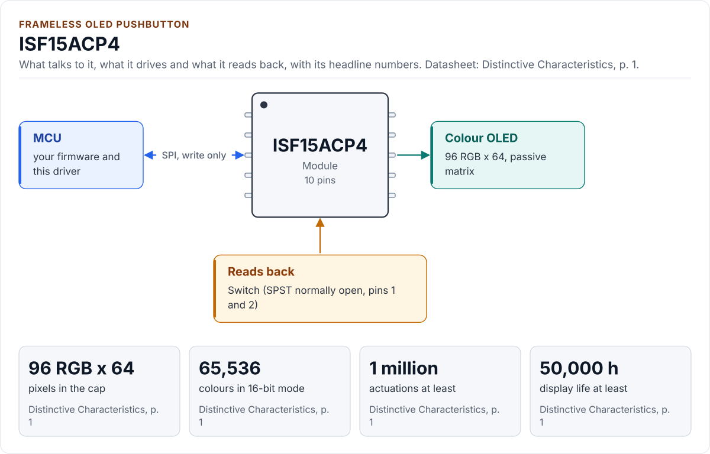
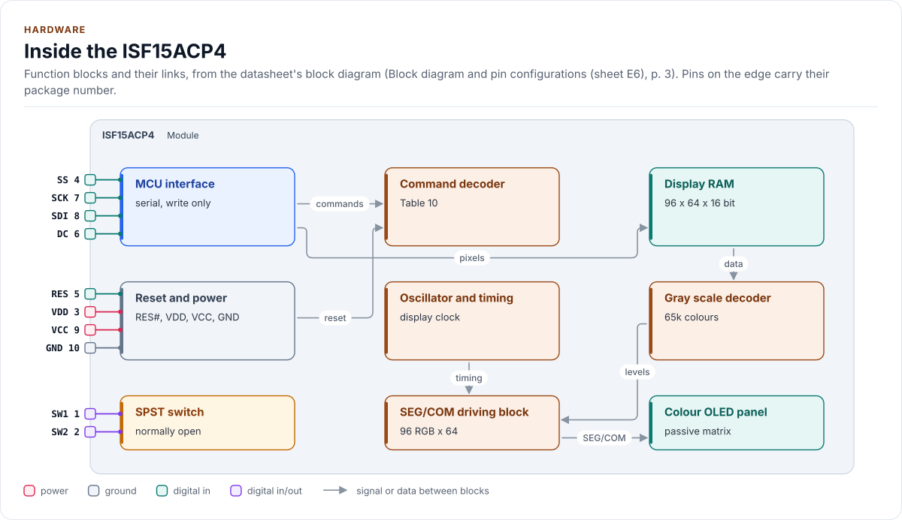
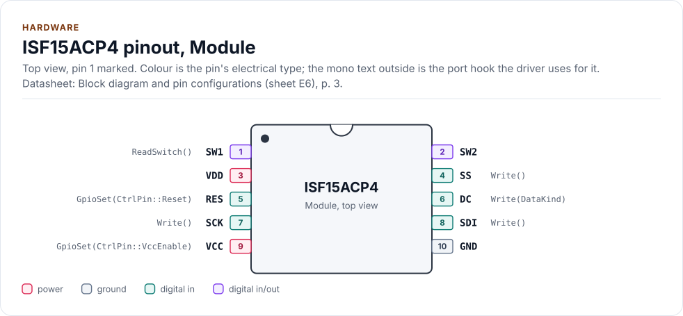
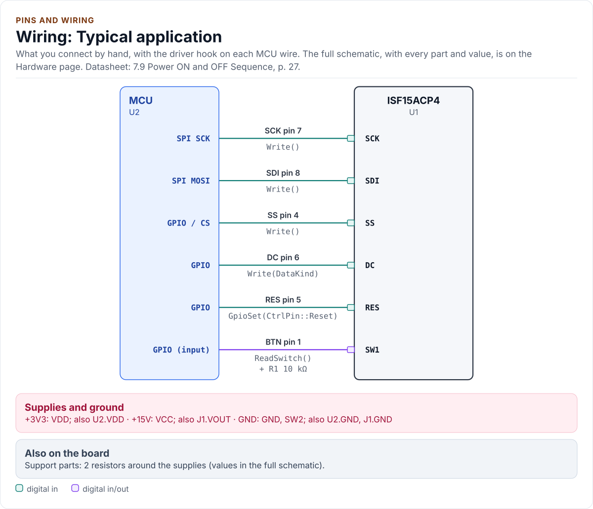
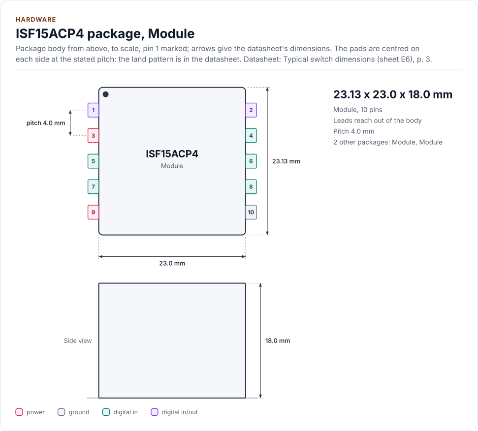
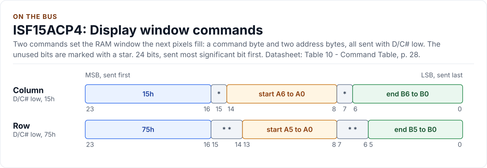

---
hide:
  - navigation
  - toc
---

<div class="kb-hero" markdown>
<span class="kb-kicker">Driver</span>

# ISF15ACP4 Driver

<p>A C++20 driver for the NKK ISF15ACP4 frameless OLED pushbutton: a 96 x 64 colour display on a write-only SPI bus
and a debounced switch, on any MCU. It powers the OLED in the order the datasheet requires, draws, scrolls and
reports button presses, long presses and repeats.</p>

[Quickstart](quickstart.md){ .md-button .md-button--primary }
[API guide](api-guide.md){ .md-button }
[Source on GitHub](https://github.com/kokeb-labs-drivers/driver-isf15acp4){ .md-button }
</div>

<!-- generated: chip-summary -->
The **ISF15ACP4** is a pushbutton with a 96 RGB x 64 colour OLED in its cap and a normally open switch under it: the
display takes commands and pixels over a write-only SPI bus, the switch is a plain contact on two pins (Distinctive
Characteristics, [p. 1](https://www.nkkswitches.com/pdf/ISF15ACP4_FramelessOLED.pdf#page=1)).
<!-- /generated -->

<!-- figure: chip-hero -->
<picture>
  <source media="(prefers-color-scheme: dark)" srcset="diagrams/chip-hero.dark.svg">
  
</picture>
<!-- /figure -->

## What it does

<!-- figure: chip-capabilities -->
<picture>
  <source media="(prefers-color-scheme: dark)" srcset="diagrams/chip-capabilities.dark.svg">
  
</picture>
<!-- /figure -->

## Where it is used

<!-- generated: chip-uses -->
- Several units combined into one screen: the sheet notes that units combine into one screen of any size and layout
- A replacement for a switch of the same footprint: same outer dimensions and footprint as current switches

Uses named by the datasheet (Distinctive Characteristics, [p.
1](https://www.nkkswitches.com/pdf/ISF15ACP4_FramelessOLED.pdf#page=1)).
<!-- /generated -->

## Inside the module

<!-- figure: chip-blocks -->
<picture>
  <source media="(prefers-color-scheme: dark)" srcset="diagrams/chip-blocks.dark.svg">
  
</picture>
<!-- /figure -->

## Pins and wiring

<!-- figure: chip-pinout -->
<picture>
  <source media="(prefers-color-scheme: dark)" srcset="diagrams/chip-pinout.dark.svg">
  
</picture>
<!-- /figure -->

<!-- figure: chip-wiring-typical -->
<picture>
  <source media="(prefers-color-scheme: dark)" srcset="diagrams/chip-wiring-typical.dark.svg">
  
</picture>
<!-- /figure -->

<!-- figure: chip-outline -->
<picture>
  <source media="(prefers-color-scheme: dark)" srcset="diagrams/chip-outline.dark.svg">
  
</picture>
<!-- /figure -->

<!-- figure: chip-frame-window -->
<picture>
  <source media="(prefers-color-scheme: dark)" srcset="diagrams/chip-frame-window.dark.svg">
  
</picture>
<!-- /figure -->

The pin tables, the full schematic and the timing are on [Hardware](hardware.md).

## Quick start

Wire the module as above, write the port for your MCU ([Porting](porting.md)), then:

<!-- generated: quickstart-code -->
```cpp
#include "isf15acp4.hpp"

int show_hello(MyPort& port) {
  isf15acp4::ISF15ACP4<MyPort> panel(port); // no I/O yet

  if (auto r = panel.EnsureInitialized();
      !r) {                           // 1. reset, configure, clear: the supply is still off
    return static_cast<int>(r.error); //    Bus or InvalidArgument: check wiring and Config
  }
  if (auto r = panel.DisplayOn(); !r) { // 2. only now is the 15 V supply enabled and the panel on
    return static_cast<int>(r.error);
  }
  if (auto r = panel.DrawRectangle(0, 0, 95, 63, isf15acp4::kWhite); !r) { // 3. draw
    return static_cast<int>(r.error);
  }
  static_cast<void>(panel.Deinitialize()); // 4. display off, supply off, wait: always runs
  return 0;
}
```
<!-- /generated -->

Every step, with the port and what to check when it does not work: [Quickstart](quickstart.md).

## Driver coverage

<!-- generated: chip-coverage -->
| Capability | What the chip does | Driver API | Registers | Status | Datasheet |
| --- | --- | --- | --- | --- | --- |
| Colour display | Writes windows, single pixels and whole frames in 65,536 or 256 colours on the 96 x 64 panel | `Present`, `WriteWindow`, `FillWindow`, `SetPixel`, `Clear` | `kSetColumnAddress`, `kSetRowAddress`, `kRemap` | Supported | OLED Specifications, [p. 2](https://www.nkkswitches.com/pdf/ISF15ACP4_FramelessOLED.pdf#page=2) |
| Drawing engine | Draws lines and rectangles, copies, dims and clears a window with the controller's own engine | `DrawLine`, `DrawRectangle`, `FillRectangle`, `CopyWindow`, `DimWindow`, `ClearWindow` | `kDrawLine`, `kDrawRectangle`, `kCopy`, `kDimWindow`, `kClearWindow` | Supported | 9.2.1, [p. 48](https://cdn-shop.adafruit.com/datasheets/SSD1331_1.2.pdf#page=48) |
| Scrolling | Scrolls a window of the display horizontally and vertically at a set speed | `SetupScroll`, `ActivateScroll`, `DeactivateScroll` | `kScrollSetup`, `kScrollOn`, `kScrollOff` | Supported | 9.2.9, [p. 51](https://cdn-shop.adafruit.com/datasheets/SSD1331_1.2.pdf#page=51) |
| Contrast and current | Sets the contrast of each colour, the master current and a dim mode | `SetContrast`, `SetMasterCurrent`, `SetDimSettings`, `DisplayDim` | `kSetContrastA`, `kMasterCurrent`, `kDimMode` | Supported | Table 10 - Command Table, [p. 28](https://cdn-shop.adafruit.com/datasheets/SSD1331_1.2.pdf#page=28) |
| Power sequence | Resets and configures the controller with the 15 V supply off, then enables it and turns the panel on | `EnsureInitialized`, `DisplayOn`, `DisplayOff`, `Deinitialize`, `CtrlPin::VccEnable` | `kDisplayOn`, `kDisplayOff`, `kMasterConfig` | Supported | 7.9, [p. 27](https://cdn-shop.adafruit.com/datasheets/SSD1331_1.2.pdf#page=27) |
| Sleep | Puts the display to sleep, 10 µA at most on each supply, and wakes it on the next press | `SetPowerSave`, `NotifyActivity` | `kPowerSave` | Supported | OLED Specifications, [p. 2](https://www.nkkswitches.com/pdf/ISF15ACP4_FramelessOLED.pdf#page=2) |
| Controller settings | Remap, start line, clock, phase periods, gray scale table, pre-charge and VCOMH of the controller | `SetRemap`, `SetStartLine`, `SetClock`, `SetGrayScaleTable`, `SetPrechargeLevel`, `SetVcomh` | `kRemap`, `kClockDivider`, `kGrayScaleTable`, `kPrechargeLevel`, `kVcomh` | Supported | 9.1.6, [p. 37](https://cdn-shop.adafruit.com/datasheets/SSD1331_1.2.pdf#page=37) |
| SPST switch | Debounces the contact and reports press, release, long press and repeat events | `Poll`, `ReadSwitchRaw`, `SetButtonConfig`, `ButtonEvent` | - | Supported | Switch specifications (sheet E5), [p. 2](https://www.nkkswitches.com/pdf/ISF15ACP4_FramelessOLED.pdf#page=2) |
| Smaller modules | Presets for the ISC15ANP4 (64 x 48, with switch) and ISC01P (52 x 36, display only) | `PresetFor`, `HasSwitch`, `Variant` | - | Supported | Block diagram and pin configurations (sheet E6), [p. 3](https://www.nkkswitches.com/pdf/ISC15ANP4.pdf#page=3) |

**Supported**: the driver covers it and a host test checks it.

From [`docs/hardware.yml`](hardware.yml); `kokeb-docs hardware --check` confirms that every API name is in
`inc/isf15acp4.hpp`, `inc/isf15acp4_types.hpp`, `inc/isf15acp4_button.hpp`, `inc/isf15acp4_spi_interface.hpp` and every
register in `inc/isf15acp4_registers.hpp`.
<!-- /generated -->

The driver has no platform code. You give it a small class that moves bytes on the SPI bus, drives three pins and
waits; it does the rest: the power sequence, the controller's initialisation, pixel windows in three colour depths, the
drawing engine, scrolling and the switch.

## What you get

- **A safe power sequence.** The OLED supply is never enabled before the controller has been reset and configured,
  and the power-down always runs. See [Contract](contract.md).
- **A display and a button, both handled.** `ISF15ACP4<YourPort>` draws pixels, rectangles and lines, scrolls, and
  `Poll()` turns the switch into events. See [API guide](api-guide.md).
- **No readback, and it says so.** The bus is write only: the driver cannot know that the controller received a byte.
  What that means and how it is tested: [Limitations](limitations.md).
- **Errors you can act on.** Every call returns `Result<T>`; an invalid argument sends nothing.
- **Zero-overhead portability.** The port is a CRTP class checked by a concept: four required hooks, optional switch,
  clock and log hooks found at compile time. See [Porting](porting.md).
- **Tested against an independent model of the controller.** The model checks the datasheet's power rules and reports
  a violation when the driver breaks one. See [Testing and CI](testing.md).

## Datasheet

<!-- generated: datasheet-card -->
| Document | Revision | Get it |
| --- | --- | --- |
| Datasheet: Frameless OLED Pushbutton ISF15ACP4 (NKK Switches ISF15ACP4_FramelessOLED (sheets E4 to E9, no number printed)) | none printed, 2019-10-03 | [PDF](https://www.nkkswitches.com/pdf/ISF15ACP4_FramelessOLED.pdf) · [vendor page](https://www.nkkswitches.com/pdf/ISF15ACP4_FramelessOLED.pdf) |
| Datasheet: SSD1331 96RGB x 64 Dot Matrix OLED/PLED Segment/Common Driver with Controller (Solomon Systech (copy from the Adafruit mirror) SSD1331) | 1.2, Nov 2007 | [PDF](https://cdn-shop.adafruit.com/datasheets/SSD1331_1.2.pdf) · [vendor page](https://cdn-shop.adafruit.com/datasheets/SSD1331_1.2.pdf) |
| Datasheet: Frameless OLED Pushbutton ISC15ANP4 (variant, 64 x 48) (NKK Switches ISC15ANP4 (sheets E4 to E9, no number printed)) | none printed, 2019-10-03 | [PDF](https://www.nkkswitches.com/pdf/ISC15ANP4.pdf) · [vendor page](https://www.nkkswitches.com/pdf/ISC15ANP4.pdf) |
| Datasheet: OLED module ISC01P (variant, 52 x 36, display only) (NKK Switches ISC01P (sheets E4 to E9, no number printed)) | none printed, 2019-10-03 | [PDF](https://www.nkkswitches.com/pdf/ISC01P.pdf) · [vendor page](https://www.nkkswitches.com/pdf/ISC01P.pdf) |
| Application note: Application Notes for the OLED Color SmartDisplay (web page) (NKK Switches OLED application notes) | none printed (web page), not printed | [vendor page](https://docs.nkkswitches.com/docs/application-notes/oled-application-notes/) |
| Application note: IS-CHPMP and IS-CHPMPHP charge pump manual (NKK Switches IS-CHPMP and IS-CHPMPHP Manual) | C, 0617 (as printed on every page) | [vendor page](https://docs.nkkswitches.com/docs/application-notes/oled-application-notes/) |
| Application note: OLED Engineering Kits User Manual (web page) (NKK Switches OLED engineering kits) | none printed (web page), not printed | [vendor page](https://docs.nkkswitches.com/docs/engineering-kits/oled-engineering-kits-user-manual/) |

Written against these revisions; the SHA-256 of each file is in [`docs/datasheets.yml`](datasheets.yml). Where each part
of the driver is in the datasheet: [Datasheet map](datasheet.md).
<!-- /generated -->

## Where to go next

<div class="grid cards" markdown>

-   :material-rocket-launch-outline: **[Quickstart](quickstart.md)**

    ---

    Wire the module, write the port, show something and read the button.

-   :material-chip: **[Hardware](hardware.md)**

    ---

    Pins, supplies, bus settings and timing.

-   :material-file-document-check-outline: **[Contract](contract.md)**

    ---

    What the driver promises, in what order it powers the display, and what it returns.

-   :material-code-braces: **[API guide](api-guide.md)**

    ---

    Start, draw, scroll, follow the button and handle errors.

-   :material-alert-circle-outline: **[Ambiguities](ambiguities.md)**

    ---

    What the datasheets leave open, and the setting that covers each case.

-   :material-book-open-variant: **[API reference](api-reference.md)**

    ---

    Every class and member, generated from the headers.

</div>
